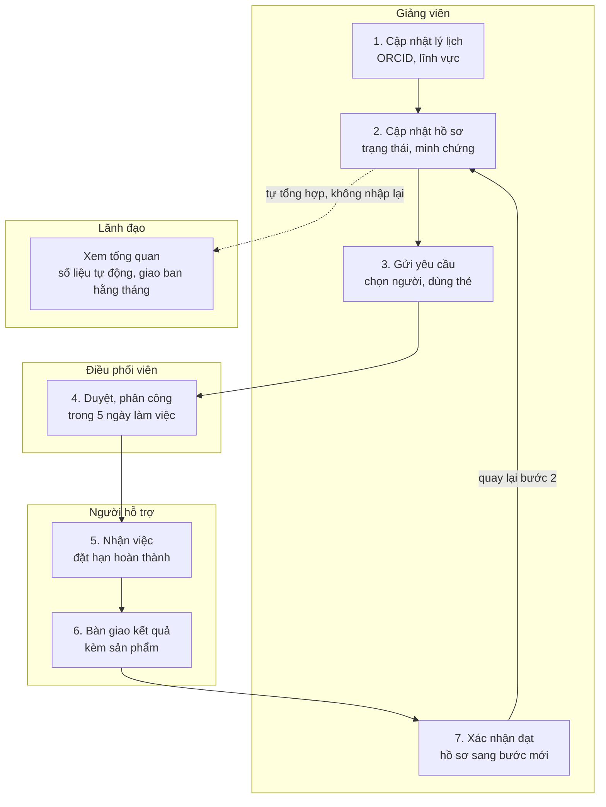

# Sáng kiến: Hệ thống online quản lý và hỗ trợ nghiên cứu khoa học (bản ý tưởng v2.0)

*Phiên bản 2.0 · 28/10/2026*

## Tóm tắt

Đề xuất chuyển dashboard hiện tại (một quản trị viên nhập liệu) thành **hệ thống online nhiều người dùng**: giảng viên tự đăng tải hồ sơ và minh chứng, đăng ký người hỗ trợ và dùng thẻ hỗ trợ; điều phối viên phân công; quản trị viên quản lý dữ liệu và tài khoản; lãnh đạo xem số liệu tự động.

Khung hệ thống lấy theo *Hệ thống quản lý nhiệm vụ khoa học và công nghệ* của Bộ KHCN (lý lịch khoa học, nhiệm vụ, trạng thái đúng hạn / sắp đến hạn / quá hạn). Điểm mới của sáng kiến là vế **hỗ trợ**: kết nối người đang vướng với người giúp được, và đo xem hỗ trợ có đến đúng lúc không.

Triển khai 3 giai đoạn, giai đoạn 1 dùng lại bản dashboard đã có. Mục 8 có 16 câu hỏi cần bạn trả lời trước khi thiết kế chi tiết.

## 1. Vì sao nâng cấp từ dashboard lên hệ thống

Dữ liệu tiến độ nằm ở giảng viên, không nằm ở quản trị viên; nên người làm nghiên cứu phải tự cập nhật được thì số liệu mới đúng và kịp thời.

- **Bản hiện tại** chỉ có một tài khoản quản trị. Mọi cập nhật phải qua một người, dễ trễ và dễ sai; giảng viên không tự gửi được yêu cầu hỗ trợ.
- **Kế hoạch 2026–2028 đã yêu cầu** một hệ thống thống nhất có phân quyền (mục 1.2, 5.10), đầu mối tiếp nhận hỗ trợ trực tuyến (mục 5.3), và các chỉ tiêu chỉ đo được khi giảng viên tự khai: hồ sơ ORCID/Scopus (chỉ tiêu 1), tỷ lệ phản hồi hỗ trợ đúng hạn (chỉ tiêu 12).
- **Hệ thống của Bộ KHCN** cho thấy mô hình đã quen với nhà khoa học: mỗi người một tài khoản, một lý lịch khoa học, danh sách nhiệm vụ có kỳ báo cáo, bảng đúng hạn / sắp đến kỳ báo cáo / quá hạn, lời mời phản biện.
- **Khác biệt cần giữ:** hệ thống của Bộ quản lý để kiểm soát (hợp đồng, báo cáo, nghiệm thu). Hệ thống của trường vừa theo dõi vừa **giúp**: thấy ai đang vướng, ai giúp được, giúp xong chưa.

## 2. Mục tiêu và nguyên tắc

Hệ thống có ba mục tiêu, mỗi mục tiêu gắn với một chỉ tiêu đã có trong Kế hoạch 2026–2028 (mục 4) để đo hiệu quả sáng kiến.

| Mục tiêu | Đo bằng | Chỉ tiêu 2026 trong Kế hoạch |
| --- | --- | --- |
| Mọi hồ sơ nghiên cứu nằm một chỗ, do chính người làm cập nhật | Giảng viên có ít nhất 1 hồ sơ đang hoạt động | ≥ 50% (chỉ tiêu 3) |
| Người cần giúp gặp được người giúp, đúng hạn | Yêu cầu được nhận trong 5 ngày làm việc | ≥ 80% (chỉ tiêu 12) |
| Lãnh đạo có số liệu không cần tổng hợp tay | Giao ban tháng và báo cáo quý lấy thẳng từ hệ thống | Theo mục 10 của Kế hoạch |

Năm nguyên tắc thiết kế:

1. **Mỗi người làm phần việc của mình.** Giảng viên cập nhật hồ sơ, người hỗ trợ cập nhật việc được giao, không ai nhập hộ ai.
2. **Nhập ít.** Một lần cập nhật tiến độ mất dưới 2 phút: trạng thái, việc tiếp theo, hạn, minh chứng nếu có.
3. **Thấy đúng phần mình.** Bản thảo chưa công bố chỉ nhóm tác giả và người được giao hỗ trợ xem được.
4. **Không giữ dữ liệu nhạy cảm.** Dữ liệu người bệnh, dữ liệu thô để ở kho của trường; hệ thống chỉ lưu đường dẫn.
5. **Làm từng phần, dùng được ngay.** Mỗi giai đoạn ra một phiên bản người dùng thật dùng được.

## 3. Người dùng và vai trò

Sáu vai trò; một người có thể giữ nhiều vai (ví dụ vừa là giảng viên vừa là người hỗ trợ thống kê).

| Vai trò | Thường là ai | Làm gì | Thấy gì |
| --- | --- | --- | --- |
| Nhà nghiên cứu | Giảng viên, nghiên cứu viên, học viên tham gia | Cập nhật lý lịch; tạo và cập nhật hồ sơ; tải minh chứng; gửi yêu cầu, chọn người hỗ trợ, dùng thẻ; xác nhận kết quả | Hồ sơ mình tham gia; danh bạ người hỗ trợ |
| Trưởng nhóm | Chủ nhiệm đề tài, trưởng nhóm nghiên cứu | Như trên, thêm: mời thành viên, phân việc trong nhóm | Mọi hồ sơ của nhóm |
| Người hỗ trợ | Chuyên gia thống kê, mentor, phản biện nội bộ, biên tập tiếng Anh; có thể là người ngoài trường | Đăng ký làm người hỗ trợ; nhận hoặc từ chối việc; đặt hạn; bàn giao | Chỉ hồ sơ và tài liệu được giao |
| Điều phối viên | Phòng KHCN, đầu mối nghiên cứu của khoa | Duyệt yêu cầu, phân công, theo dõi hạn, nhắc việc | Hồ sơ trong phạm vi điều phối |
| Lãnh đạo | Ban Giám hiệu, trưởng khoa | Xem tổng quan, quyết định nguồn lực | Số liệu tổng hợp; chi tiết khi cần |
| Quản trị viên | 1–2 người của Phòng KHCN hoặc CNTT | Tạo và duyệt tài khoản; quản lý danh mục; cấp thẻ hỗ trợ; sao lưu | Toàn bộ, kèm nhật ký thay đổi |

## 4. Các phân hệ chức năng

Đề xuất 12 phân hệ, 8 phân hệ cần cho giai đoạn 1. Bốn phân hệ không có bên Bộ KHCN (4, 6, 7, 9) là phần riêng của sáng kiến.

| # | Phân hệ | Làm gì | Tương đương bên Bộ KHCN | Giai đoạn |
| --- | --- | --- | --- | --- |
| 1 | Trang của tôi | Việc sắp đến hạn, hồ sơ đang tham gia, hỗ trợ đang chờ; thống kê đúng hạn / sắp đến hạn / quá hạn | Trang chủ (Thống kê tình hình nhiệm vụ) | 1 |
| 2 | Lý lịch khoa học | Học hàm, học vị, lĩnh vực, ORCID / Scopus ID, danh mục công bố | Lý lịch khoa học | 1 |
| 3 | Hồ sơ nghiên cứu | Tạo hồ sơ, cập nhật 14 trạng thái (Phụ lục 3), tải minh chứng, mời thành viên | Nhiệm vụ | 1 |
| 4 | Yêu cầu hỗ trợ | Gửi yêu cầu, chọn người hỗ trợ, theo dõi đến khi xác nhận đạt | Không có | 1 |
| 5 | Người hỗ trợ | Danh bạ chuyên gia; đăng ký làm người hỗ trợ; việc được giao | Được mời phản biện; Nhà khoa học yêu thích | 1 |
| 6 | Thẻ hỗ trợ | Hạn mức quyền lợi hỗ trợ của mỗi người hoặc nhóm (xem mục 5) | Không có | 2 |
| 7 | Chương trình & sự kiện | Đăng ký trại viết bài, phòng khám bản thảo, chương trình 90 ngày, seminar | Không có | 2 |
| 8 | Kinh phí | Đề nghị hỗ trợ phí công bố, quỹ hạt giống, giải ngân theo mốc | Hợp đồng tài trợ | 2 |
| 9 | Tạp chí | Cơ sở dữ liệu tạp chí ưu tiên, phiếu chọn tạp chí (Phụ lục 2) | Không có | 3 |
| 10 | Thông báo & văn bản | Thông báo, văn bản, biểu mẫu, hướng dẫn sử dụng | Thông báo; Công văn; Hướng dẫn sử dụng | 1 |
| 11 | Báo cáo | Tổng quan, giao ban tháng, báo cáo quý theo chỉ tiêu Kế hoạch | Báo cáo; Đánh giá | 1 |
| 12 | Quản trị | Tài khoản, duyệt đăng ký, phân quyền, danh mục, nhật ký thay đổi | Phần quản trị | 1 |

Bản dashboard hiện có đã làm sẵn một phần phân hệ 3, 4 và 11; giai đoạn 1 chủ yếu thêm tài khoản nhiều người, lý lịch và danh bạ người hỗ trợ.

## 5. Người hỗ trợ và thẻ hỗ trợ

“Thẻ hỗ trợ” có ba cách hiểu. Tôi đề xuất hiểu là **hạn mức quyền lợi (cách B)**, còn mỗi lần xin giúp là một **yêu cầu** trừ vào thẻ.

| Cách hiểu | Hoạt động thế nào | Hợp khi |
| --- | --- | --- |
| A. Phiếu yêu cầu | Mỗi lần cần giúp tạo một phiếu; phiếu đi qua Mới gửi → Đang xử lý → Đã xong | Chỉ cần theo dõi; bản hiện tại đã có, chỉ cần đổi tên |
| B. Hạn mức quyền lợi | Đầu năm quản trị cấp cho mỗi giảng viên hoặc nhóm một số lượt, ví dụ 2 lượt hiệu đính tiếng Anh, 10 giờ tư vấn thống kê; mỗi yêu cầu được nhận thì trừ lượt | Nguồn lực hỗ trợ có hạn, cần chia công bằng và tránh chi trùng (Kế hoạch mục 5.8) |
| C. Thẻ tham gia chương trình | Đăng ký vào chương trình 90 ngày, trại viết, phòng khám bản thảo; thẻ ghi quyền lợi và cam kết (mốc tuần, sản phẩm bắt buộc) | Trường triển khai các chương trình ở Kế hoạch mục 5.4 |

Các con số ở cách B chỉ là ví dụ; mức cấp thật do trường quyết định. Vòng đời một thẻ theo cách B: cấp đầu năm → dùng khi gửi yêu cầu → người hỗ trợ xác nhận đã dùng → hết hạn cuối năm, báo cáo đã dùng / còn lại.

“Đăng ký người hỗ trợ” nên chạy theo cả hai chiều:

- **Làm người hỗ trợ:** chuyên gia tự đăng ký lĩnh vực, loại hỗ trợ, số việc nhận tối đa mỗi tháng và điều kiện; quản trị duyệt rồi đưa vào danh bạ.
- **Chọn người hỗ trợ:** khi gửi yêu cầu, giảng viên chọn từ danh bạ hoặc để điều phối chọn; người hỗ trợ bấm nhận hoặc từ chối; hệ thống chặn khi người đó đã đủ việc.
- **Ghi nhận công sức:** mỗi việc xong được tính cho người hỗ trợ, làm căn cứ quy đổi giờ hoặc khen thưởng (Kế hoạch mục 5.5).

## 6. Hành trình sử dụng chính

Một yêu cầu hỗ trợ đi qua ba người và quay về giảng viên; lãnh đạo đọc số liệu từ chính các bước đó.

Bước 3 là điểm mới so với hệ thống của Bộ: giảng viên tự chọn người hỗ trợ và dùng thẻ. Quản trị viên đứng ngoài luồng này: duyệt tài khoản, duyệt người hỗ trợ, cấp thẻ đầu năm.

## 7. Lộ trình triển khai

Ba giai đoạn khớp với Master Plan của Kế hoạch (MP-06, MP-07 quý IV/2026; MP-09 năm 2027; MP-11 năm 2028). Mỗi giai đoạn chỉ bắt đầu khi qua “cổng” của giai đoạn trước.

| Giai đoạn | Thời gian | Nội dung | Cổng để sang giai đoạn sau |
| --- | --- | --- | --- |
| GĐ0 · Đã có | 10/2026 | Dashboard 1 quản trị; hồ sơ, yêu cầu hỗ trợ; cảnh báo cần chú ý | Cổng 1: chốt câu hỏi mục 8, có người vận hành |
| **GĐ1 · Thí điểm** | Quý IV/2026, 1–2 khoa | Tài khoản, phân quyền; lý lịch khoa học; hồ sơ + minh chứng; danh bạ người hỗ trợ; nhắc việc qua email | Cổng 2: 10–15 hồ sơ cập nhật đều 2 tháng |
| GĐ2 · Mở rộng | 2027, toàn trường | Thẻ hỗ trợ (hạn mức); chương trình, sự kiện; kinh phí hỗ trợ; báo cáo quý theo KPI | Cổng 3: đánh giá giữa kỳ 12/2027 |
| GĐ3 · Hoàn thiện | 2028 | CSDL tạp chí ưu tiên; kết nối ORCID, Scopus; báo cáo tác động; kế hoạch 2029–2031 | — |

Thẻ hỗ trợ và kinh phí để giai đoạn 2 vì cần trường chốt quy chế và ngân sách trước; giai đoạn 1 tập trung vào việc mọi người có tài khoản và cập nhật đều.

## 8. Câu hỏi cần bạn trả lời

Có 16 câu hỏi; năm câu in đậm (1, 2, 5, 9, 13) cần trả lời trước khi làm giai đoạn 1. Cột cuối là gợi ý của tôi; bạn sửa thẳng vào ô hoặc để bình luận.

| # | Câu hỏi | Vì sao cần biết | Gợi ý của tôi |
| --- | --- | --- | --- |
| **1** | **Năm đầu dùng cho 1–2 khoa thí điểm hay toàn trường? Khoảng bao nhiêu người dùng?** | Quyết định cách cấp tài khoản, chi phí và khối lượng hỗ trợ | Trong 1 năm đầu, thí điểm 02 khoa |
| **2** | **Đơn vị nào sở hữu hệ thống, ai làm quản trị hằng ngày?** | Không có người vận hành thì dữ liệu cũ dần | Phòng KHCN sở hữu; 1 quản trị chính, 1 dự phòng |
| 3 | Sau 1 năm, thế nào là thành công? | Hồ sơ sáng kiến cần số liệu trước / sau | Dùng 3 chỉ tiêu ở mục 2; đo mức nền ngay khi mở hệ thống |
| 4 | Tên gọi chính thức của hệ thống là gì? | Dùng trên giao diện, văn bản, truyền thông | Ví dụ “Cổng hỗ trợ và quản lý nghiên cứu TDU” |
| **5** | **Tài khoản: tự đăng ký bằng email trường rồi chờ duyệt, hay quản trị tạo sẵn?** | Ảnh hưởng công sức quản trị và bảo mật | Tự đăng ký bằng email của trường, quản trị duyệt |
| 6 | Đăng nhập bằng tài khoản Google hoặc Microsoft của trường được không? | Bớt một mật khẩu phải nhớ | Có, nếu trường đang dùng một trong hai |
| 7 | Trưởng khoa có xem được nội dung hồ sơ của giảng viên trong khoa không? | Cân bằng giữa quản lý và quyền riêng của bản thảo | Xem trạng thái và hạn; tệp bản thảo chỉ nhóm tác giả mở được |
| 8 | Người ngoài trường (bệnh viện, chuyên gia, đồng tác giả) có tài khoản không? | Cần loại tài khoản khách và phạm vi xem riêng | Có; tài khoản khách chỉ thấy việc được giao |
| **9** | **“Thẻ hỗ trợ” theo cách A, B hay C ở mục 5?** | Đổi thiết kế dữ liệu và quy trình duyệt | B, kết hợp A |
| 10 | Ai được làm người hỗ trợ? Có thù lao hoặc quy đổi giờ không? | Không được ghi nhận thì khó giữ người hỗ trợ lâu dài | Tự đăng ký, quản trị duyệt; quy đổi giờ theo quy chế trường |
| 11 | Giảng viên được chọn đích danh người hỗ trợ, hay điều phối phân công? | Quyết định luồng duyệt và cách chống quá tải | Giảng viên đề xuất, điều phối chốt |
| 12 | Ai xác nhận việc hỗ trợ đạt? Có đánh giá người hỗ trợ không? | Tránh “xong trên giấy” | Người gửi xác nhận; phản hồi 1–5 sao, chỉ quản trị xem |
| **13** | **“Đăng tải dữ liệu” gồm những gì: thông tin, bản thảo, minh chứng, hay cả dữ liệu nghiên cứu?** | Quyết định dung lượng lưu trữ và rủi ro bảo mật | Thông tin và minh chứng nhỏ; bản thảo, dữ liệu để ở Drive/OneDrive của trường, hệ thống lưu đường dẫn |
| 14 | Có cần nhắc việc qua email hoặc Zalo không? | Không nhắc thì người dùng quên cập nhật | Email trước; Zalo khi có nhu cầu |
| 15 | Có người CNTT và ngân sách vận hành không? | Quyết định dùng dịch vụ miễn phí hay máy chủ của trường | Bắt đầu bằng dịch vụ miễn phí; chuyển lên máy chủ trường khi mở rộng |
| 16 | Có cần kết nối hệ thống Bộ KHCN, hệ thống nhân sự, hay xác thực VNeID không? | Kết nối tốn công, chỉ nên làm khi bắt buộc | Kết nối với hệ HEMIS của bộ giáo dục và đào tạo |

## 9. Rủi ro và lưu ý

Rủi ro lớn nhất không phải kỹ thuật mà là người dùng không cập nhật; mọi thiết kế nên ưu tiên giảm công nhập liệu.

| Rủi ro | Hậu quả | Cách giảm |
| --- | --- | --- |
| Giảng viên không cập nhật | Số liệu cũ, lãnh đạo mất tin, hệ thống bị bỏ | Cập nhật dưới 2 phút; nhắc việc tự động; giao ban tháng mở thẳng trên hệ thống thay vì báo cáo giấy |
| Lộ bản thảo chưa công bố hoặc dữ liệu người bệnh | Vi phạm bảo mật, mất uy tín | Phân quyền theo hồ sơ; không lưu dữ liệu thô; chỉ lưu đường dẫn tới kho của trường |
| Người hỗ trợ quá tải hoặc bỏ cuộc | Yêu cầu tồn, giảng viên thôi gửi | Khai số việc nhận tối đa; chặn khi đủ việc, người nào hết slot hỗ trợ sẽ không được booking nữa; ghi nhận công sức |
| Phụ thuộc một người làm kỹ thuật | Người đó nghỉ là hệ thống đứng | Công nghệ phổ biến, tài liệu hướng dẫn, sao lưu định kỳ, giao CNTT trường khi mở rộng |
| Dùng số liệu để chấm điểm cá nhân | Giảng viên khai đẹp hoặc ngại khai | Quy định rõ: số liệu để phân bổ hỗ trợ, không để đánh giá năng lực (nguyên tắc DORA) |
| Thẻ hỗ trợ bị dùng sai mục đích | Nguồn lực dồn vào vài người, chi trùng | Hạn mức theo năm, người hỗ trợ xác nhận từng lượt, báo cáo đã dùng / còn lại |

Về công nghệ: giai đoạn 1 có thể chạy trên dịch vụ miễn phí (GitHub Pages + Supabase), đã chuẩn bị sẵn trong bản hiện tại. Khi mở rộng toàn trường, nên chuyển lên hạ tầng do CNTT trường quản lý.
